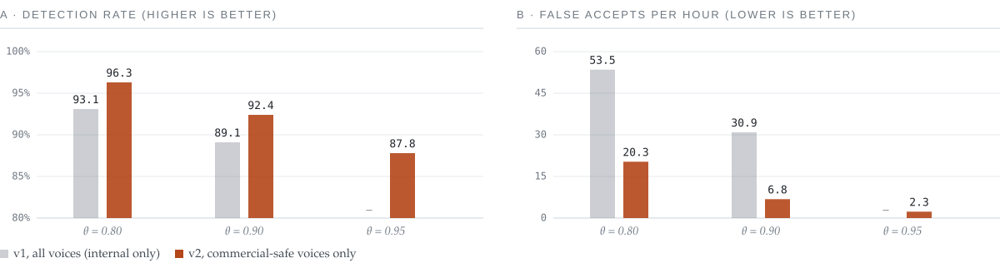

# Hey Cerebel

<sub>Keyword spotting · TC-ResNet, about 20k parameters · C runtime on the glasses · 100% synthetic training data · code under MIT</sub>

The **"Hey Cerebel"** wake word for Cerebel AI's AR glasses. This repo has everything needed to reproduce it: the trained model, the C inference code compiled into the glasses firmware, the training and export scripts, and the full synthetic speech dataset.

<picture>
  <source media="(prefers-color-scheme: dark)" srcset="docs/assets/wake-dark.svg">
  
</picture>

## Contents

| Path | What it is |
|---|---|
| `model/wake.pt` | **v2, production model.** Trained only on commercially licensed voices (`train.py --commercial`) |
| `model/v1/` | v1. Uses non-commercial data, so it is for **internal testing only** |
| `model/wake_model.h` | The v2 weights exported as a C array, compiled straight into `cerebel-mic` on the glasses |
| `model/report.txt` | Evaluation on held-out speakers |
| `code/` | Data generation, training, export and packaging scripts, plus the on-device C inference (`wake.c` / `wake.h`) and a parity test |
| `dataset/pos/` | 3,299 "Hey Cerebel" clips (16 kHz mono WAV) |
| `dataset/neg/` | 8,544 negatives: near-homophones (*Hey Siri, Isabel, celebrate…*), everyday sentences, and 3,000 LLM-written casual dialogue lines |
| `dataset/manifest.csv` | Per-clip label, source voice, voice license, and whether it is cleared for commercial use |
| `dataset/negative_sentences.txt` | Source text for the LLM-written negatives |

## How it was built

- **All speech is synthetic.** Clips come from three multi-speaker [Piper](https://github.com/rhasspy/piper) TTS models (LibriTTS-R with 904 speakers, VCTK with 109, and L2-ARCTIC with 24 non-native speakers) plus built-in macOS voices. Each speaker is rendered at several speaking rates and random pitch.
- **Augmented at train time.** Augmentation adds background noise, room reverb, a frequency response modelled on the small glasses microphone, and random gain. Half-phrases ("Hey …") are used as negatives so the model doesn't fire on "Hey" alone.
- **Input.** 40-dimensional log-mel features over a 1.5 s window. The glasses run one decision every 50 ms, each under 1M multiply-accumulates.
- **Bit-faithful port.** The C implementation is checked score-by-score against PyTorch, with a maximum absolute difference below **4 × 10⁻⁶**.

## Results

<picture>
  <source media="(prefers-color-scheme: dark)" srcset="docs/assets/results-dark.svg">
  
</picture>

**v2 (production).** Tested on speakers never seen in training, using 53 min of hard negatives and everyday dialogue.

| Threshold θ | Detection rate | False accepts / hour |
|---|---|---|
| 0.80 | 96.3% | 20.3 |
| **0.85** | *glasses default* | |
| 0.90 | 92.4% | 6.8 |
| 0.95 | 87.8% | 2.3 |

**v1.** Tested on speakers never seen in training, 29 min.

| Threshold θ | Detection rate | False accepts / hour |
|---|---|---|
| 0.80 | 93.1% | 53.5 |
| 0.90 | 89.1% | 30.9 |

False accepts were measured on the hardest possible set, deliberately packed with near-homophones, so everyday speech triggers far less often. On the glasses, the score must also clear the threshold on **two consecutive decisions**, and the cloud then re-verifies every trigger.

## Licensing of the audio

The `commercial_use` column in `manifest.csv` marks every clip:

- **Commercial use OK (with attribution).** LibriTTS-R and VCTK voices, both CC BY 4.0. That is 3,039 positives and 5,455 negatives.
- **Not for commercial use.** That is 260 positives and 3,089 negatives in total:
  - macOS system voices: Apple's license allows personal, non-commercial use only.
  - L2-ARCTIC voices: the dataset is CC BY-NC 4.0.

**v1 was trained on non-commercial data and is for internal testing only. The v2 model in `model/` uses commercial-safe data only.** The dataset still contains every clip; filter with `manifest.csv`. This summary reflects my reading of each project's license. Have it reviewed by counsel before a commercial launch.

## Usage

```bash
python code/gen_data.py data                  # positives + near-homophone negatives (needs piper-tts and voice models)
python code/gen_negatives.py data             # a local LLM writes everyday sentences, then they are synthesized as negatives
python code/train.py data out --commercial    # train on commercial-safe voices only
python code/export.py out test.wav            # export C weights and print parity scores
```

**On the glasses.** Copy `wake_model.h` into `cerebel_shell/include/` and rebuild `cerebel-mic` (in the private firmware repo).

## What would help most next

**Real recordings of "Hey Cerebel" through the glasses microphone.** Ideally different people, distances, tones and noisy environments, about 20 to 50 takes per person, plus a few hours of everyday conversation recorded while wearing the glasses to use as negatives.

## Attribution (required by CC BY 4.0)

- Speech synthesis: [Piper](https://github.com/rhasspy/piper) (MIT), voices from [rhasspy/piper-voices](https://huggingface.co/rhasspy/piper-voices).
- LibriTTS-R: Koizumi et al., 2023, CC BY 4.0.
- VCTK: CSTR, University of Edinburgh, CC BY 4.0.
- L2-ARCTIC: Zhao et al., 2018, CC BY-NC 4.0 (non-commercial).

## License

The code in `code/` is released under the [MIT License](LICENSE). The audio in `dataset/` keeps the license of the voice that produced it (see `manifest.csv`), and the models inherit the restrictions of the data they were trained on.
